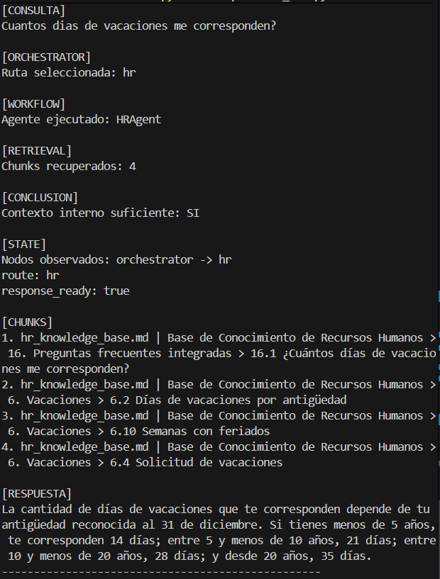
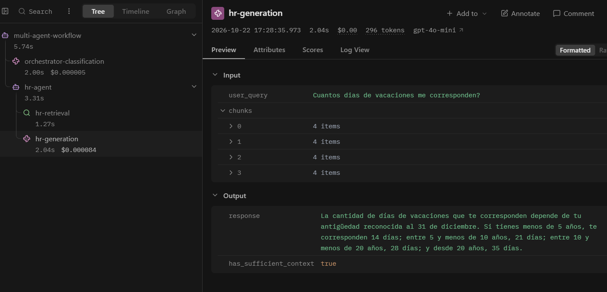

# Multi-Agent Support System

An internal support system that classifies employee queries and routes them to **HR**, **Technical Support**, or **Finance** specialists. Each specialist retrieves evidence from its own knowledge base and generates an answer using that context. The included Markdown documents describe a fictional SaaS company.

The system combines **LangGraph conditional routing**, domain-specific **RAG**, **OpenAI models and embeddings**, persistent **Chroma** collections, and **Pydantic structured outputs**. Optional **Langfuse** instrumentation exposes the workflow stages, while a separate response evaluator can assess completed answers.

[Demo](#demo) · [Architecture](#architecture) · [Interactive CLI](#interactive-cli) · [Evaluation](#evaluation) · [Installation](#installation) · [Current Limitations](#current-limitations)

## What it does

1. Receives an employee support query.
2. An orchestrator classifies it into `hr`, `tech`, `finance`, or `out_of_scope` using structured output.
3. LangGraph conditionally routes the shared state to exactly one terminal node.
4. The selected specialist retrieves relevant chunks from its domain's Chroma collection.
5. The specialist generates a structured answer, with an indication of whether the retrieved context is sufficient. Queries classified as `out_of_scope` receive a clarification fallback instead.
6. When configured, Langfuse records classification, retrieval, generation, and the final workflow result.
7. The CLI can optionally run a response evaluator after displaying the answer.

## Demo

### CLI workflow

A verbose HR query shows the `hr` route, `HRAgent`, four retrieved chunks, the `orchestrator -> hr` node sequence, chunk references, and the final response.



### Langfuse trace

The matching HR trace separates classification, retrieval, and generation. The selected generation shows the query, four chunk references, the response, and `has_sufficient_context = true`.



## Key Results

- **12 labeled end-to-end evaluation queries:** three expected routes each for HR, Tech, Finance, and out-of-scope, including a mixed-domain query, a vague query, and an insufficient-evidence case.
- **224 chunks across three knowledge bases:** HR **119**, Tech **53**, and Finance **52**, reproduced from the current Markdown sources and confirmed against the local persisted indexes.

These counts describe the included evaluation set and retrieval corpus. No saved end-to-end run report is versioned, so a measured routing success rate is not claimed here. See [Evaluation](#evaluation) for the checks the runner performs.

## Tech Stack

| Technology | Role |
| --- | --- |
| Python 3.11+ | Typed workflow state, agents, and CLI. |
| LangGraph 1.x | Graph nodes, shared state, and conditional routing. |
| LangChain | Chat prompts, model interfaces, documents, splitters, and retrievers. |
| OpenAI chat models | Classification, specialist responses, and optional evaluation. |
| OpenAI embeddings | Embeds knowledge-base chunks and retrieval queries. |
| Chroma via `langchain-chroma` | Persistent local vector collections, one per domain. |
| Pydantic 2.x | Structured routing, specialist responses, and evaluator schemas. |
| Langfuse Python SDK 4.x | Optional workflow and stage observations. |
| python-dotenv | Loads local environment configuration. |

[`.env.example`](.env.example) selects `gpt-4o-mini` for chat and `text-embedding-3-small` for embeddings; these are configurable values, not hard-coded model defaults. [`requirements.txt`](requirements.txt) declares dependency version ranges rather than a fully locked environment.

## Architecture

```text
User query: {user_query}
    |
    v
START -> Orchestrator (structured route)
             |
             v
      LangGraph conditional edges
             |
             +-- hr ----------> HR RAG node -------+
             +-- tech --------> Tech RAG node -----+
             +-- finance -----> Finance RAG node --+
             +-- out_of_scope -> Clarification ----+
                                                   |
                                                   v
                                        END -> {route, response}
```

[`src/multi_agent_system.py`](src/multi_agent_system.py) defines the graph and its `TypedDict` contracts: `InputState` accepts `user_query`, `OverallState` carries the query, route, and response, and `OutputState` exposes `route` and `response`. Each RAG node performs retrieval followed by specialist generation, then transitions to `END`.

Langfuse observes executions through the traced workflow wrappers. It does not participate in route selection.

## Key Engineering Decisions

### Structured routing

[`OrchestratorAgent`](src/agents/orchestrator.py) uses `with_structured_output(OrchestratorDecision, method="json_schema")`. A `Literal` restricts the route to four values, avoiding free-text parsing for branch selection. Schema validation constrains the routing contract; it does not guarantee that a semantically valid route is the correct one.

### Conditional routing with LangGraph

The graph explicitly represents typed state, an orchestrator node, three specialist nodes, a fallback node, and conditional edges. The route stored in state selects one branch, making the execution path inspectable without implementing a second router in the CLI.

### Domain isolation

Each specialist handler is wired to its own Markdown source, Chroma collection, and retriever. This bounds retrieval to the selected domain and keeps unrelated HR, Tech, and Finance context out of that specialist's prompt.

### Retrieval separated from generation

[`src/knowledge/`](src/knowledge) owns loading, chunking, vector stores, and retrieval. [`src/agents/`](src/agents) owns classification and context-based response generation. The workflow connects those responsibilities and supports injected handlers without changing the graph topology.

### Persistent vector stores

Chroma collections are stored locally under `data/vector_stores/<domain>/`. Non-empty collections are reused to avoid re-embedding the knowledge bases on every run; empty collections are populated from the Markdown sources. The indexes are rebuildable artifacts and are excluded from Git.

### Structured evaluation outside the workflow

`ResponseEvaluator` returns a validated score object and runs separately from routing and answer generation. The CLI uses its safe evaluation path so an evaluator failure leaves the completed support response available.

## How the RAG Pipelines Work

1. **Load Markdown.** Each domain has one source knowledge-base document.
2. **Split by headers.** `MarkdownHeaderTextSplitter` recognizes `#`, `##`, and `###`, retains headers in the content, and preserves document title, section, and subsection metadata.
3. **Chunk sections.** `RecursiveCharacterTextSplitter` applies `chunk_size=800` and `chunk_overlap=120`, measured in characters. Chunks retain their source, section path, index, and chunking settings.
4. **Embed and persist.** `OpenAIEmbeddings` uses `EMBEDDING_MODEL`; Chroma opens or builds the selected domain's local collection.
5. **Retrieve and answer.** A similarity retriever returns up to `k=4` chunks by default. The specialist receives those documents as context and is instructed to answer only from their evidence.

| Domain | Markdown source | Current chunks | Local index directory |
| --- | --- | --- | --- |
| HR | [`hr_knowledge_base.md`](data/hr_docs/hr_knowledge_base.md) | 119 | `data/vector_stores/hr/` |
| Tech | [`tech_knowledge_base.md`](data/tech_docs/tech_knowledge_base.md) | 53 | `data/vector_stores/tech/` |
| Finance | [`finance_knowledge_base.md`](data/finance_docs/finance_knowledge_base.md) | 52 | `data/vector_stores/finance/` |

Chunking is implemented in [`markdown_documents.py`](src/knowledge/markdown_documents.py); persistence and embeddings are configured in [`vector_store.py`](src/knowledge/vector_store.py). Each domain has a separate retriever factory.

The first query routed to an unindexed domain builds its collection and makes OpenAI embedding calls. Existing collections are reused without checking whether their source files have changed, so knowledge-base edits require rebuilding the affected index.

Specialist structured responses contain `response` and `has_sufficient_context`. Empty context produces a predefined insufficient-context answer without a generation call. For non-empty context, sufficiency is assessed by the model; factual grounding is a prompt constraint, not an independently verified guarantee.

## Orchestrator

`OrchestratorAgent` classifies the query without answering it:

| Route | Intended scope |
| --- | --- |
| `hr` | Employment relationship, leave, benefits, payroll receipts, and people processes. |
| `tech` | Accounts, devices, VPN, internal tools, systems, and technical troubleshooting. |
| `finance` | Expenses, invoices, reimbursements, procurement, and financial administration. |
| `out_of_scope` | Unsupported requests, queries too vague to classify, or mixed-domain queries without a clear primary owner. |

The prompt requests exactly one route. A blank query returns `out_of_scope` without a classification call. Mixed queries with no primary domain and unrelated questions share the same fallback, which asks the user to identify an area or provide more context. There is no automatic decomposition into multiple intents.

## Interactive CLI

The console demo reuses `stream_workflow` and the real graph:

```bash
python scripts/chat_cli.py
python scripts/chat_cli.py --verbose
python scripts/chat_cli.py --evaluate
```

- Enter a free-form query, or choose `1` for an HR example, `2` for Tech, or `3` for Finance.
- Use `ayuda` / `help` to show guidance and `salir` / `exit` to finish.
- Normal output shows the selected route, specialist, retrieved chunk count, context-sufficiency assessment, and final response.
- `--verbose` adds observed node updates and compact chunk references without printing the knowledge-base text.
- `--evaluate` assesses each completed response after it is displayed, adding one model invocation. It can be combined with `--verbose`.

The built-in examples and menu are in Spanish. Queries make real OpenAI API calls; initial index construction also incurs embedding usage. Follow [Installation](#installation) before running the demo.

## Evaluation

### End-to-end routing checks

[`scripts/run_mvp_tests.py`](scripts/run_mvp_tests.py) executes the 12 labeled cases in [`test_queries.json`](test_queries.json):

```bash
python scripts/run_mvp_tests.py
```

| Expected route | Cases | Coverage |
| --- | --- | --- |
| `hr` | 3 | Vacation, sick leave, and an unsupported benefit requiring an insufficient-context answer. |
| `tech` | 3 | VPN access, MFA after a phone change, and a damaged laptop. |
| `finance` | 3 | Reimbursement, approved invoices, and supplier bank-account changes. |
| `out_of_scope` | 3 | An unrelated question, a mixed HR/Tech request, and a vague request. |

For each case, the runner checks the expected route, the terminal node, and a non-empty response. The designated insufficient-evidence case also checks for specific Spanish phrases indicating unavailable internal context. A case is marked `PASS` only when all its checks pass.

The script prints per-case JSON and `routing_accuracy=<correct>/<total>`. Routing accuracy uses route matches only; the other checks contribute to per-case status. The runner does not evaluate factual answer accuracy or calculate precision, recall, or F1, and it does not set a failing process exit code when cases are marked `FAIL`.

The repository does not retain a run report from which to independently verify a routing score. The command requires live OpenAI calls and is separate from the optional model-based evaluator below.

### Offline CLI checks

[`tests/test_chat_cli.py`](tests/test_chat_cli.py) contains six unit tests using a fake workflow and evaluators. They cover example mapping, free queries, empty input and exit commands, opt-in evaluation, and evaluator failure isolation. They do not measure the real models' routing or answer quality.

```bash
python -m unittest discover -s tests -p "test_chat_cli.py"
```

## Optional Response Evaluator

[`ResponseEvaluator`](src/evaluation/evaluator.py) uses structured output to assess a completed response against its query and any retrieved context:

| Field | Contract |
| --- | --- |
| `relevance` | Integer score from 1 to 10. |
| `completeness` | Integer score from 1 to 10. |
| `accuracy` | Integer score from 1 to 10, based on the supplied evidence. |
| `overall_score` | Integer score from 1 to 10. |
| `reason` | Non-empty explanation. |

This is an LLM assessment of an individual answer, not a measured benchmark for system-wide response accuracy. The evaluator prompt requests conservative scoring when evidence is missing or insufficient.

The evaluator adds a model invocation and is outside the main graph. `evaluate_safely()` returns `None` on failure; the CLI also catches evaluator initialization failures. When Langfuse is enabled, the evaluator records its output and four numeric trace scores. In the CLI it runs after the workflow trace has closed, rather than as a node inside that workflow.

## Installation

Use **Python 3.11 or newer within the Python 3 series** and run these commands from the repository root (`m3` in this workspace).

### 1. Create and activate a virtual environment

Windows PowerShell:

```powershell
python -m venv .venv
.\.venv\Scripts\Activate.ps1
```

macOS / Linux:

```bash
python3 -m venv .venv
source .venv/bin/activate
```

### 2. Install dependencies

```bash
python -m pip install -r requirements.txt
```

### 3. Configure environment variables

Copy [`.env.example`](.env.example) to `.env`, keeping any existing configured file.

Windows PowerShell:

```powershell
Copy-Item .env.example .env
```

macOS / Linux:

```bash
cp .env.example .env
```

For local execution without tracing, configure:

```dotenv
OPENAI_API_KEY=your-key-here
OPENAI_MODEL=gpt-4o-mini
EMBEDDING_MODEL=text-embedding-3-small
LANGFUSE_PUBLIC_KEY=
LANGFUSE_SECRET_KEY=
LANGFUSE_HOST=
```

Set a real OpenAI key and model names available to your account. `OPENAI_MODEL` is used by the orchestrator, specialists, and evaluator; `MODEL_NAME` is also accepted as a fallback. `EMBEDDING_MODEL` configures retrieval embeddings.

**Langfuse is optional locally.** To use no-op instrumentation, leave all three `LANGFUSE_*` values empty or unset, including the host. Clear the placeholder values if you copied the example file. To enable tracing, fill in both keys and set `LANGFUSE_HOST` to your project's region or instance URL, for example `https://cloud.langfuse.com`. A partial configuration raises an explicit error.

The `.env` file and generated vector stores are excluded from Git. Source knowledge bases are included, so no index download is required.

## Usage

The minimal entry point compiles the graph, invokes the fixed query `Consulta de ejemplo`, and prints its output:

```bash
python -m src.multi_agent_system
```

For traced programmatic execution, use the public wrappers:

```python
from src.multi_agent_system import invoke_workflow, stream_workflow

result = invoke_workflow({"user_query": "Cuantos dias de vacaciones me corresponden?"})
print(result["route"])
print(result["response"])
```

`stream_workflow` accepts the same input and yields graph node updates, rather than streamed answer tokens. The minimal module entry point calls the compiled graph directly; use the wrappers or interactive CLI for the `multi-agent-workflow` root observation.

## Observability with Langfuse

[`src/observability/langfuse.py`](src/observability/langfuse.py) centralizes optional tracing. A specialist execution through a traced wrapper has this observation hierarchy:

```text
multi-agent-workflow                 [agent]
├── orchestrator-classification      [generation]
└── <domain>-agent                   [agent]
    ├── <domain>-retrieval           [retriever]
    └── <domain>-generation          [generation]
```

For an unsupported query, `out-of-scope` replaces the specialist branch. Optional evaluation creates a separate `response-evaluator` observation after the CLI displays the response.

The instrumentation records the query, selected route, final answer, configured chat model, selected domain, collection name, retrieval `k`, chunk count, and generation's context-sufficiency flag. Retrieved chunks are represented only by **source name, section path, chunk index, and character count**, rather than their full text.

Errors within active observations record their stage, exception type, and a shortened message with token-shaped values redacted, then propagate to the caller. The current manual instrumentation does not attach LLM token usage or monetary costs. The interactive CLI and end-to-end evaluation script flush pending observations before exit.

## Validation and Error Handling

| Area | Implemented behavior |
| --- | --- |
| Configuration | Explicit errors for missing OpenAI credentials, chat/embedding model names, or partially configured Langfuse. |
| Queries and outputs | Agents reject non-string queries; blank queries and empty context have defined fallbacks. Pydantic constrains route, response, and evaluation payloads; invalid returned payloads can raise agent-specific errors. |
| Retrieval | Validates positive `k`, valid chunk size/overlap, non-empty document collections, and non-empty collection names. File loading, embedding, and Chroma failures propagate. |
| Model/API failures | Propagate from classification or generation; the CLI catches per-query exceptions, prints the exception type, and remains available for the next query. |
| Evaluator | Safe evaluation returns `None` on failure, leaving the main response available. |
| Observability | No-op when fully unconfigured. Enabled tracing errors can propagate; the CLI suppresses shutdown flush failures. |

The graph normalizes unexpected route values from handlers to `out_of_scope` and substitutes fallback text for blank terminal responses. This does not turn raised classifier, API, or retrieval exceptions into successful fallback answers. There is no application-level provider failover.

## Current Limitations

- **One query, one domain.** No multi-intent decomposition, specialist handoffs, or parallel routing.
- **Similarity retrieval without reranking.** The default retrieves up to four chunks, without a relevance-score threshold.
- **Manual index refresh.** Knowledge-base or embedding-model changes require rebuilding the affected persisted collections; existing indexes are not checked for freshness.
- **Grounding still needs review.** The sources are fictional, schema validation does not establish factual accuracy, and context sufficiency for non-empty retrieval is judged by the model.
- **Limited evaluation coverage.** The 12-case runner checks routing and basic response behavior; it does not establish general answer quality. Optional evaluator scores are model judgments.
- **OpenAI dependency.** Classification, embeddings, response generation, and optional evaluation require OpenAI access.
- **Remote tracing requires Langfuse.** Local no-op mode runs without it but does not provide Langfuse observability.

## Future Improvements

- Expand routing and answer-grounding regression coverage and retain reproducible run reports.
- Explore reranking and automatic detection of stale indexes.
- Add multi-intent support and controlled specialist handoffs if broader query handling is needed.

## Project Structure

```text
.
├── README.md
├── requirements.txt
├── .env.example
├── test_queries.json
├── data/
│   ├── hr_docs/hr_knowledge_base.md
│   ├── tech_docs/tech_knowledge_base.md
│   └── finance_docs/finance_knowledge_base.md
├── scripts/
│   ├── chat_cli.py
│   └── run_mvp_tests.py
├── src/
│   ├── multi_agent_system.py
│   ├── agents/                      # Orchestrator and domain specialists
│   ├── knowledge/                   # Loaders, chunking, stores, retrievers
│   ├── evaluation/evaluator.py
│   └── observability/langfuse.py
└── tests/
    └── test_chat_cli.py
```

Developed as the Module 3 final project for an AI Engineering program.
